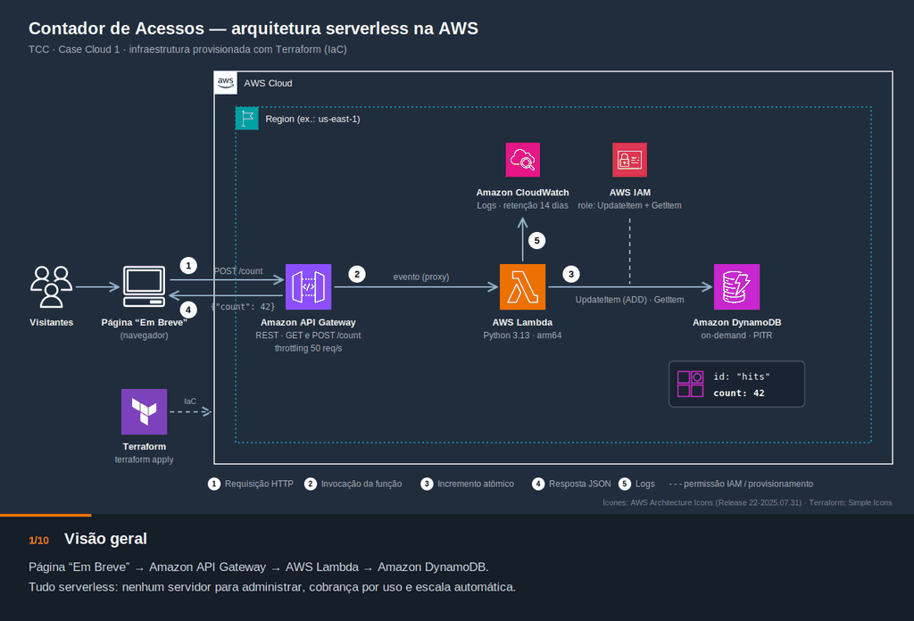

# TCC — Contador de Acessos Serverless na AWS

Contador de acessos para a página "Em Breve" de uma campanha de marketing, implementado
com **Amazon API Gateway + AWS Lambda + Amazon DynamoDB**, provisionado com **Terraform** e
entregue por uma pipeline de **GitHub Actions**.



Diagrama estático: [docs/arquitetura.svg](docs/arquitetura.svg)

## Organização do repositório

```
.
├── .github/workflows/
│   └── terraform.yml            # CI/CD: plan no push da main; apply/destroy manuais
├── boot-strap/                  # Fundação (roda 1x, localmente): bucket de state + role OIDC do GitHub Actions
├── infra/                       # Infra do contador (Terraform, state remoto no S3)
│   ├── backend.tf · main.tf · variables.tf · output.tf
│   ├── env/dev.tfvars.example
│   └── modules/
│       ├── lambda/              # Função, role de execução e log group
│       ├── api-gateway/         # REST API GET/POST /count, CORS e throttling
│       └── dynamodb/            # ⚠️ em branco — guia de implementação no README (M4)
├── backend/
│   └── contador/handler.py      # Código da Lambda (empacotado pelo Terraform)
├── frontend/
│   └── index.html               # Página "Em Breve" de demonstração (local, não implantada)
└── docs/                        # Arquitetura, requisitos, backlog, handoffs...
```

O código da Lambda (`backend/`) não depende da ferramenta de IaC: o módulo `lambda` gera o
zip a partir de `backend/contador` a cada `plan`.

## Como colocar no ar

### 1. Bootstrap (uma vez, com credenciais de administrador)

Cria o bucket do state remoto, o OIDC provider do GitHub e a role que a pipeline assume.
Passo a passo em **[boot-strap/README.md](boot-strap/README.md)**.

```bash
cd boot-strap
cp terraform.tfvars.example terraform.tfvars   # ajuste os valores
terraform init && terraform apply
```

### 2. Configurar o repositório no GitHub

Em **Settings → Secrets and variables → Actions**, use os outputs do bootstrap:

| Tipo | Nome | Valor |
|---|---|---|
| Secret | `AWS_ROLE_ARN` | `project_role_arn` |
| Variable | `TF_STATE_BUCKET` | `s3_bucket_name` |
| Variable | `AWS_REGION` | `s3_bucket_region` |

Em **Settings → Environments**, crie o environment **`dev`** e configure:

- **Deployment branches and tags → Selected branches → `main`.** Obrigatório: impede que um
  `apply`/`destroy` disparado de outra branch assuma a role da AWS.
- **Required reviewers.** Opcional: exige aprovação antes de cada `apply`/`destroy`.

### 3. Pipeline (`.github/workflows/terraform.yml`)

| Evento | O que roda |
|---|---|
| Push na `main` que altere `infra/`, `backend/` ou o workflow | `py_compile` do handler, `fmt -check` (infra + boot-strap), `init`, `validate` e `plan` |
| **Actions → Terraform CI/CD → Run workflow → `plan`** | Igual ao push |
| … → `apply` | `plan -out` e `apply` do mesmo plano, no Environment `dev`, só a partir da `main`. O resumo do job mostra o `count_endpoint` |
| … → `plan-destroy` | Mostra o que seria destruído |
| … → `destroy` | Destrói a infra, no Environment `dev`, só a partir da `main` |

A autenticação na AWS usa **OIDC**: nenhuma chave de acesso fica guardada no GitHub.

### 4. Testar

```bash
URL="<count_endpoint do resumo do apply>"
curl -s -X POST "$URL"   # {"count": 1}
curl -s "$URL"           # {"count": 1}
```

> Enquanto o módulo `dynamodb` estiver em branco, a API responde `500`. Esse é o
> comportamento esperado. Veja [infra/modules/dynamodb/README.md](infra/modules/dynamodb/README.md).

Para ver o contador subindo no navegador (e testar CORS e concorrência), use a página de
demonstração: [frontend/README.md](frontend/README.md).

Para rodar o Terraform localmente, veja **[infra/README.md](infra/README.md)**.

## Documentação

- [Arquitetura](docs/arquitetura.md) · [Handoffs](docs/handoffs.md)
- [Backlog](docs/backlog.md) · [Sprints](docs/sprints.md) · [Definition of Done](docs/definition-of-done.md)
- [Levantamento de requisitos](docs/Levantamento_Requisitos_Contador_de_Acessos_AWS.md)
