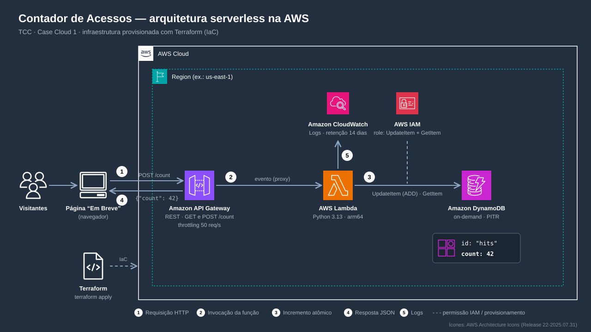

# Arquitetura da Solução



Fluxo passo a passo (animado): [fluxo-contador.gif](fluxo-contador.gif)

## Fluxo Principal

```
Usuário (Browser/App)
        │
        ▼
┌─────────────────┐
│  API Gateway     │  ← HTTPS endpoint (REST API)
│  POST /count     │     Recebe a requisição
│  GET  /count     │     Retorna o total
└────────┬────────┘
         │ (invoca)
         ▼
┌─────────────────┐
│  AWS Lambda      │  ← Função serverless
│  (Python/TS)     │     Lógica: incrementa ou lê
└────────┬────────┘
         │ (UpdateItem / GetItem)
         ▼
┌─────────────────┐
│  DynamoDB        │  ← Tabela: AccessCounter
│  PK: id = "hits" │     Atributo: count (N)
│  Attr: count     │
└─────────────────┘
```

## Serviços e Justificativas

| Serviço | O que faz | Por que foi escolhido | Alternativas consideradas |
|---------|-----------|----------------------|--------------------------|
| **API Gateway** | Recebe requisições HTTP, roteia para Lambda | Managed, escala automaticamente, cobra por requisição | ALB (mais caro para baixo volume), AppSync (GraphQL desnecessário) |
| **Lambda** | Executa lógica de incremento/leitura | Serverless, paga só quando executa, escala de 0 a milhões | EC2 (custo fixo), Fargate (overhead para função simples) |
| **DynamoDB** | Armazena contador | Latência < 10ms, serverless, escala automática (on-demand) | RDS (overhead relacional), ElastiCache (volátil) |
| **IAM** | Controla permissões entre serviços | Obrigatório na AWS, princípio do menor privilégio | N/A |

## Endpoints da API

| Método | Rota | Ação | Resposta |
|--------|------|------|----------|
| `POST` | `/count` | Incrementa o contador em +1 | `{"count": 42}` |
| `GET` | `/count` | Retorna o valor atual | `{"count": 42}` |

## Schema do DynamoDB

```json
{
  "TableName": "AccessCounter",
  "KeySchema": [
    { "AttributeName": "id", "KeyType": "HASH" }
  ],
  "AttributeDefinitions": [
    { "AttributeName": "id", "AttributeType": "S" }
  ],
  "BillingMode": "PAY_PER_REQUEST"
}
```

**Item armazenado:**
```json
{
  "id": { "S": "hits" },
  "count": { "N": "42" }
}
```

## Segurança

- **IAM Role da Lambda:** Somente `dynamodb:UpdateItem` e `dynamodb:GetItem` na tabela específica (ARN exato, não `*`)
- **API Gateway:** Endpoint público (sem auth — é um contador de acesso público)
- **DynamoDB:** Encryption at rest habilitada (padrão com chave gerenciada AWS)
- **Sem VPC:** Todos os serviços são serverless e se comunicam via endpoints AWS — VPC adicionaria latência sem benefício

## Escalabilidade

| Serviço | Como escala | Limite prático |
|---------|------------|---------------|
| API Gateway | Automático | 10.000 req/s (soft limit, aumentável) |
| Lambda | Concorrência automática | 1.000 execuções simultâneas (padrão, aumentável) |
| DynamoDB (On-Demand) | Automático | Virtualmente ilimitado |

## Estimativa de Custos (região us-east-1)

| Cenário | API Gateway | Lambda | DynamoDB | Total/mês |
|---------|-----------|--------|----------|-----------|
| 100 acessos/mês | ~$0.00 | ~$0.00 | ~$0.00 | **Free Tier** |
| 10.000 acessos/mês | ~$0.04 | ~$0.00 | ~$0.01 | **~$0.05** |
| 1.000.000 acessos/mês | ~$3.50 | ~$0.20 | ~$1.25 | **~$4.95** |

> Valores aproximados. Usar AWS Pricing Calculator para estimativa formal.
